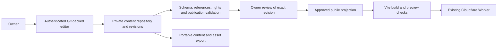

# Proposed Content Studio and migration

Status: proposal; approval required before substantial implementation. Product: a digital observatory and field notebook, “Seeing What Systems Miss,” with the editorial concept “Things That Didn't Add Up.” No database, CMS, new public IA or content conversion is installed by the stability patch.

## Recommendation: prove Git-backed authoring first

Keep React/TypeScript/Vite and the existing Cloudflare Worker. Trial Pages CMS against a private content repository, using structured Markdown plus YAML/JSON metadata and explicit relationship records. Its documentation describes content collections, rich text, reference and UUID fields. A usable owner workflow, secure token handling, revisions, branch preview and restoration must be demonstrated before adoption. Do not assume a reference field alone supplies relationship governance or a rich spatial editor.

A private content repository keeps restricted drafts out of the public application source. Only an approved, validated public projection is placed in the public application/build. Git visibility is repository-wide: a draft status in a public repository does not make an entry private, and deleting a file does not erase history. CI fetching private content must use least-privilege server-side credentials; never serialize those credentials into Vite variables or browser responses. A public preview must not contain restricted drafts, even if links are hidden. Owner-only draft preview needs authenticated server delivery (including assets), or a controlled local workflow until that exists.

No CMS is approved until it proves that repository write credentials remain server-side, authentication and authorization work, unpublished media cannot leak, and Sam can perform the complete workflow without code. Pages CMS hosted/service security and current pricing need confirmation, not assumption. Avoid a custom OAuth implementation just to force a product fit.

| Approach | Benefits | Cost and maintenance | Main limitation / decision |
|---|---|---|---|
| Git-backed Pages CMS trial | Existing Git ownership, portable files/history, collection and reference fields; lowest initial infrastructure | Hosted option may reduce operations; confirm current terms and quotas. Private repository, build minutes and media storage may add cost. Self-hosting adds app/auth/database operations. | Must prove preview, publish approval, permissions and multi-field relationship UX; no adoption on documentation alone. |
| Decap CMS + GitHub | Portable Markdown and mature editorial patterns | OAuth/backend setup and integrations require maintenance; hosting/build usage still applies. | Standard browser GitHub token flow conflicts with the “no browser repository-write credentials” requirement. Do not use that flow unchanged. |
| Worker API + D1 + R2 + owner auth | Precise relationship editing and server-side authorization; fits existing hosting | More custom engineering: editor, migrations, revision store, backups, auth, CSRF and recovery. Quota-based hosting, not a guaranteed zero bill. | Fallback only if the Git-backed vertical slice fails a documented authoring/security requirement. Export must remain provider-neutral. |

Do not introduce a graph database, vector store, AI runtime or framework migration. The core site and editor must function without AI. A later assistant may propose records with explicit provenance; it cannot approve interpretations or publish.

## Canonical model (version 1 proposal)

Store content apart from presentation. Validate on save where supported and always before preview/publication. Reusable components render optional blocks, not a compulsory investigation formula. Use stable UUIDs internally; readable immutable slugs with explicit aliases externally. Preserve all existing fragment URLs and do not silently fabricate unknown dates.

| Record | Fields and invariants |
|---|---|
| Entry | `schemaVersion`, `id`, unique `slug`, `type`, `title`, `summary`, `editorialStatus` (draft/review/approved/published/withdrawn), `visibility` (public/restricted), `createdAt`, `revisedAt`, `authors`, `contributors` with role/credit, `blocks`, `evidenceIds`, `relationshipIds`, `aliases`, `revision`, `publicationApproval`. Supported types: investigation, observation, pattern, perspective, case, experiment, field_note, reference. |
| Optional editorial blocks | curiosity/question, context, assumption, observation, evidence, interpretation, consequence, decision, recommendation, implemented_intervention, measured_outcome, persistence, limitation, next_question; rich text, image, SVG, diagram and citation blocks. Preserve distinction between observed and experimental work. Missing data stays missing; a recommendation never becomes implementation through template wording. |
| Evidence / reference | Stable ID, source and locator, artifact type, provenance, observation/collection date when known, evidence state, author/collector and contributors, citation, rights/license/permission, redaction and visibility, claim IDs supported/challenged, limitations. Separate direct evidence from interpretation and disputed claims. |
| Asset | ID, file, MIME, checksum, alt text or decorative flag, caption, creator, rights and permission, visibility, derivative IDs, evidence links. Sanitize SVG; do not execute embedded HTML/scripts. Quarantine private originals and serve reviewed derivatives only. |
| Relationship | Stable ID, source/target entry IDs, typed relation, direction, human rationale, evidence IDs, proposed/approved/rejected state, proposedBy (human/AI plus provenance), reviewedBy/date, created/revised metadata and revision. Only owner-approved relationships between published public entries enter public output. |
| Publication | Exact approved content revision/commit, approver, approvedAt, publish action, deployed revision, prior release and restoration reference. Editing an approved revision invalidates its publication approval. Store revisions append-only or through Git history; restoration creates a new revision. |

Evidence states: documented observation, supported finding, working hypothesis, exploratory speculation, disputed interpretation, unresolved question. State labels express editorial judgments, not computed certainty.

Directional relations: supports, challenges, extends, illustrates, contradicts, depends_on, emerged_from. Symmetric association: shares_pattern. Canonicalize symmetric endpoints for duplicate checks; preserve direction for other records. A backlink reverses navigation and displays the correct explanatory wording; it does not invent a second assertion. Validate endpoint existence, duplicate IDs/slugs, unknown types, broken citations, private endpoints, accidental self-links, duplicate relations, aliases and internal URLs. Evidence citations and directional rationale remain visible in the text interface as well as the graph.

Published schemas should retain unknown future fields safely through explicit versioned migration. Authoring must not require code for each new entry. A new schema-level content type still requires deliberate versioning, not an unchecked arbitrary renderer.

## Editorial workflow and security gates

1. Owner authenticates; server authorizes access to the private repository/content scope. Sessions, token scopes, CSRF, revocation and sign-out are verified. No embedded shared password or frontend repository-write token.
2. Save a draft with revisions and durable media; reload in a new session and confirm persistence. Proposed AI suggestions remain visibly proposed.
3. Review evidence, contribution, rights, accessibility and publication safety. Restricted inputs cannot be selected into public output accidentally.
4. Preview the exact candidate with page and graph/text relationships. Restricted draft previews are owner-authenticated, not merely hard to guess.
5. Owner approves a specific revision, then explicitly publishes. Build failures preserve the previous working release and report actionable status. Repeated publish requests are safe; concurrent edits cannot overwrite unseen revisions.
6. Edit/unpublish/restore through the same interface. Warn about incoming links; retain stable URL behavior. Unpublishing removes public assets when required and addresses caches; it cannot promise erasure of already public copies.
7. Export content, relationships, rights metadata and media with checksums. Restore into a fresh test checkout/storage and demonstrate a rebuild. Keep private exports private and encrypted where appropriate.

An approval field editable by anyone with write access is insufficient for multiple roles. Initially restrict publication authority to Sam; collaboration requires enforced server permissions before invitations.

## Preserve content and prove independence

First obtain Emergent source/data export, authenticated feature access if needed, and a private asset inventory. Compare Editor's Assistant, Thread Review, owner auth, existing URLs/layouts, intro, drafts/publication and unpublished assets using the audit inventory. Sam identifies the latest approved version. Archive both sources outside public outputs; test restoration before moving anything.

Then implement one complete, reviewed Claims investigation, one “Delivered ≠ Complete” pattern, and one explicitly approved explanatory relationship. The pattern is an interpretation; no unsupported shared cause is asserted. Preserve contribution boundaries and source references. Sam must create/edit, connect, preview, publish, revise, export and restore this slice without touching code. Include the earlier requested acceptance: a new Observation with three meaningful approved connections persists after deployment. Generalize only after both authoring tasks pass.

The accessibility case needs special reconciliation: AI detected and restored deliberately removed accessibility code; a human developer separately caught weak red/green distinction between Focus and Break states during planned review. Do not merge these into one AI failure or invent a causal outcome. Current prototype metrics and employer-sensitive claims require source/rights review rather than automatic migration.

For each existing ID/URL, record the approved content revision and destination; generate redirects/anchor compatibility and test old links. Migrate a copy first, compare text/relationship counts and visuals, rehearse rollback, then request publication approval. Adopt Home / Investigations / Patterns / Perspective / About incrementally only after the content and navigation review; the graph remains an optional cross-sectional discovery route.

## Phased roadmap and release gates

| Phase | Deliverable and dependency | Acceptance / risk gate |
|---|---|---|
| 0: stability | This small PR; owner routes domain to working Worker | Green build/browser checks; inspect a hosted branch preview separately from production; complete manual access checks; explicit approval before production. Domain still needs external correction. |
| 1: source reconciliation | Emergent access/export + owner review; preserve both versions | Feature-parity ledger, approved editorial baseline, URL/rights inventory and verified private backups. No replacement before this gate. |
| 2: content slice | Approve schema + Git-backed trial; migrate reviewed Claims/pattern/relationship | Validated portable files, reusable reading views, preserved fragment links, no restricted data in artifact, integrity tests and accessible preview. |
| 3: editorial independence | Secure editor/auth and protected preview | Sam performs slice workflow and Observation/three-links acceptance; new-session persistence, revision approval, unpublish, export/restore and denial tests pass. Reject CMS if this cannot be done without code. |
| 4: connected archive | Only after slice and parity gates pass | Migrate in reviewed batches; typed explanations/backlinks, filtering, stable graph layout and equivalent keyboard/text access. No unreviewed inferred relationships. |
| 5: keyboard investigation | Research question/input options approved separately | Evidence-labelled investigation; optional isolated prototype with accessible baseline and consent-based evaluation. Cannot block publishing work. |
| 6: hardening | Real author/visitor experience drives scope | Restore drill, dependency/security review, media controls, larger-network performance and optional human-reviewed AI suggestions. |

Expand CI alongside implemented phases: schema and relationship unit tests; API/session/permission and concurrent-save integration tests; owner save/preview/publish/rollback browser tests; public-artifact privacy and broken-link checks. Do not describe those future tests as passing today.

Measure usefulness through optional task-based feedback: can visitors state the question, separate evidence/interpretation, identify Sam's contribution and limits, and explain a connection? Start without session replay, typed-content collection or cross-site tracking. Collect aggregate completion/feedback only with an explicit purpose and minimal retention.

Architecture references consulted: [Pages CMS configuration](https://pagescms.org/docs/configuration/), [Pages CMS documentation](https://pagescms.org/docs/), [Decap GitHub backend](https://decapcms.org/docs/github-backend/), [Cloudflare static assets](https://developers.cloudflare.com/workers/static-assets/). Product fit, current costs, security and complete authoring UX still require the trial; documentation is not proof of readiness.
